<picture>
  <source media="(prefers-color-scheme: dark)" srcset="./assets/banner-dark.svg">
  
</picture>

  
  
  
  

IT systems professional based in Catalunya, Spain. I administer production infrastructure in the hospitality
sector — identity, endpoints, perimeter security and the automation around them — and I am building an
offensive security skill set to move into penetration testing and red team work.

<picture>
  <source media="(prefers-color-scheme: dark)" srcset="./assets/terminal-dark.svg">
  
</picture>

  

## Selected work

<table>
  <tr>
    <td width="50%">
      <picture>
        <source media="(prefers-color-scheme: dark)" srcset="./assets/card-incident-dark.svg">
        
      </picture>
    </td>
    <td width="50%">
      <picture>
        <source media="(prefers-color-scheme: dark)" srcset="./assets/card-server-dark.svg">
        
      </picture>
    </td>
  </tr>
  <tr>
    <td width="50%">
      <picture>
        <source media="(prefers-color-scheme: dark)" srcset="./assets/card-inventory-dark.svg">
        
      </picture>
    </td>
    <td width="50%">
      <a href="https://krwpulse.com">
        <picture>
          <source media="(prefers-color-scheme: dark)" srcset="./assets/card-pipeline-dark.svg">
          
        </picture>
      </a>
    </td>
  </tr>
</table>

### How these systems fit together

<picture>
  <source media="(prefers-color-scheme: dark)" srcset="./assets/flows-dark.svg">
  
</picture>

  

## Dashboard — internal IT platform

The internal IT tool I built for a hotel group. It replaces spreadsheets, emails and scattered notes
with one place for inventory, a helpdesk, network monitoring and the day-to-day running of the team.
Two doors: staff report faults through a simple no-login portal, IT works from a full panel behind 2FA.

<picture>
  <source media="(prefers-color-scheme: dark)" srcset="./assets/dashboard-dark.svg">
  
</picture>

<table>
  <tr>
    <td width="33%" valign="top">
      <b>Inventory & monitoring</b> 
      
      Every device — PCs, POS, switches, routers, cameras, radio links, printers, UPS 
      IP, MAC, VLAN, hotel, building, location, owner, state 
      Automatic ping status (responding / down / unchecked) 
      Search operators: <code>vlan:40</code>, <code>estado:!activo</code> 
      Incomplete-record queue + per-building view
      
    </td>
    <td width="33%" valign="top">
      <b>Helpdesk</b> 
      
      Staff incident portal, no login required 
      AI assistant or direct form, with self-fix tips 
      Full ticket lifecycle (INC-0042 → resolved) 
      Priorities, states and email acknowledgements 
      IT sees new incidents in the panel instantly
      
    </td>
    <td width="33%" valign="top">
      <b>Tools & organization</b> 
      
      Network topology: switches, uplinks, radio links 
      Subnet calculator + VLSM, VLAN table, free-IP map 
      Material orders and daily work logs 
      Multi-hotel, accounts with roles + mandatory 2FA 
      Import / export PDF · CSV · JSON, demo mode
      
    </td>
  </tr>
</table>

Scale: ~450 devices across several hotels. Dark theme, responsive, formal register, no telemetry. Mockup shows demo data.

 

## Certification path

<picture>
  <source media="(prefers-color-scheme: dark)" srcset="./assets/roadmap-dark.svg">
  
</picture>

<b>Education</b> · Higher Vocational Diploma in Network Systems Administration (CFGS ASIX), in progress · Vocational Diploma in Microcomputer Systems and Networks (CFGM SMX)

  

## Stack

<b>Systems & infrastructure</b>

 

<b>Network & security</b>

 

<b>Automation & development</b>

 

 

## Skill radar

<picture>
  <source media="(prefers-color-scheme: dark)" srcset="./assets/radar-dark.svg">
  
</picture>

 

All security testing is performed in lab environments or on platforms where I am explicitly authorized.
