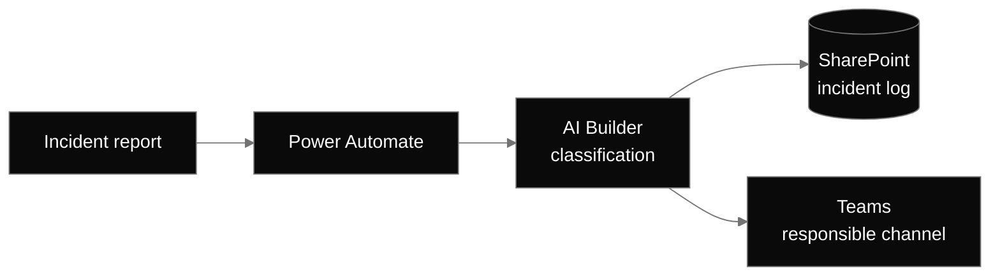
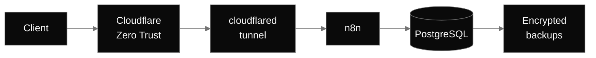
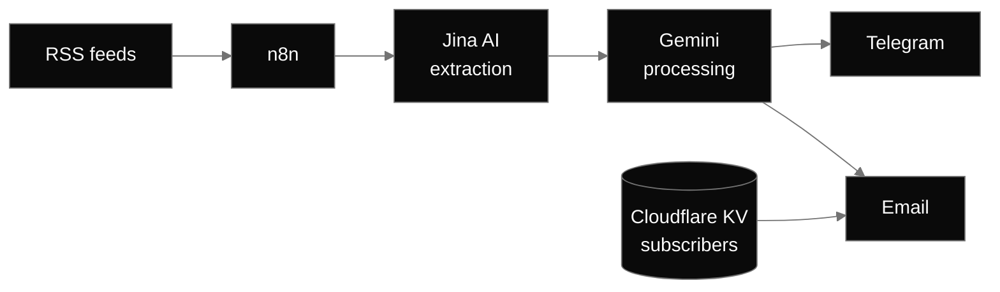

<picture>
  <source media="(prefers-color-scheme: dark)" srcset="./assets/banner-dark.svg">
  
</picture>

  
  
  
  

IT systems professional based in Catalunya, Spain. I administer production infrastructure in the hospitality
sector — identity, endpoints, perimeter security and the automation around them — and I am building an
offensive security skill set to move into penetration testing and red team work.

<picture>
  <source media="(prefers-color-scheme: dark)" srcset="./assets/terminal-dark.svg">
  
</picture>

  

## Selected work

<table>
  <tr>
    <td width="50%">
      <picture>
        <source media="(prefers-color-scheme: dark)" srcset="./assets/card-incident-dark.svg">
        
      </picture>
    </td>
    <td width="50%">
      <picture>
        <source media="(prefers-color-scheme: dark)" srcset="./assets/card-server-dark.svg">
        
      </picture>
    </td>
  </tr>
  <tr>
    <td width="50%">
      <picture>
        <source media="(prefers-color-scheme: dark)" srcset="./assets/card-inventory-dark.svg">
        
      </picture>
    </td>
    <td width="50%">
      <a href="https://krwpulse.com">
        <picture>
          <source media="(prefers-color-scheme: dark)" srcset="./assets/card-pipeline-dark.svg">
          
        </picture>
      </a>
    </td>
  </tr>
</table>

<b>Architecture — IT incident workflow</b>

 

<b>Architecture — Self-hosted n8n</b>

 

<b>Architecture — KRW Pulse pipeline</b>

 

 

## Certification path

<picture>
  <source media="(prefers-color-scheme: dark)" srcset="./assets/roadmap-dark.svg">
  
</picture>

<b>Education</b> · Higher Vocational Diploma in Network Systems Administration (CFGS ASIX), in progress · Vocational Diploma in Microcomputer Systems and Networks (CFGM SMX)

  

## Stack

<b>Systems & infrastructure</b>

 

<b>Network & security</b>

 

<b>Automation & development</b>

 

 

## Activity

<picture>
  <source media="(prefers-color-scheme: dark)" srcset="https://raw.githubusercontent.com/karwin-security/karwin-security/output/snake-dark.svg">
  
</picture>

 

All security testing is performed in lab environments or on platforms where I am explicitly authorized.
